<div align="center">

# DHWANI

**A vision-guided unmanned ground vehicle that drives from point A to point B without GPS**

[](https://www.sih.gov.in/sih2026PS)
[](https://www.sih.gov.in/sih2026PS)
[](http://wiki.ros.org/melodic)
[](https://developer.nvidia.com/embedded/jetson-nano)
[](https://docs.luxonis.com)
[](LICENSE)

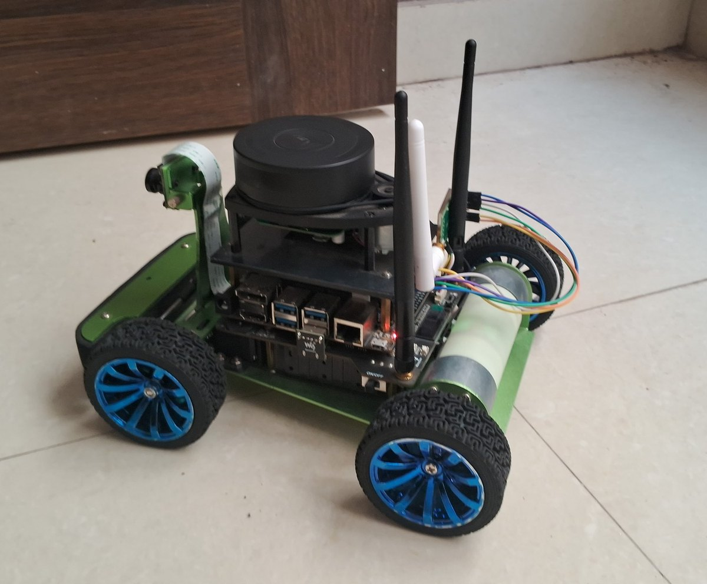

Team FABLE 5 (SA-HW-12) | MIT School of Computing, MIT ADT University, Pune

</div>

---

GPS works well on an open road, but a small ground vehicle loses it under trees, between tall buildings
and inside structures, which are exactly the places where rescue, defence and farm robots are needed.
For SIH 2026, Bharat Electronics Limited asked for a UGV that goes from point A to point B outdoors with
cameras as its primary sensor (problem statement SIH26126). DHWANI is our answer, and it is a working rover.

It runs on a Waveshare JetRacer with a Jetson Nano, a Luxonis OAK-D stereo depth camera, an RPLidar A1,
an IMU and wheel odometry. The camera gives depth and runs a YOLOv6-nano detector on its own chip at
10 frames a second. Mapping, planning and decision making all run on the rover, so it keeps going when the
network does not. You can type a mission in plain English, and watch, drive or stop the rover from any
phone or laptop without installing anything.

Every result in this README was measured on the real rover and carries its date. Anything that only ran in
simulation is labelled as simulation.

## Links

| | |
|---|---|
| Rover driving clips | [dhwani-videos.vercel.app](https://dhwani-videos.vercel.app) |
| Simulator video | [Google Drive](https://drive.google.com/file/d/1m9kO9FVVMEcE7RmZlXUjOMIAyd5HXINf/view?usp=sharing) |
| NVIDIA Newton training notebook | [Kaggle](https://www.kaggle.com/code/rudrakshbharti/sih-dhwani-rover-newton-mujoco-ppo-training) |
| Mission parser weights | [Release v1.0](https://github.com/CTAGRAM/DHWANI-UGV/releases/tag/v1.0) |

## Contents

- [How it meets the problem statement](#how-it-meets-the-problem-statement)
- [Architecture](#architecture)
- [Results on the real rover](#results-on-the-real-rover)
- [What is not proven yet](#what-is-not-proven-yet)
- [Hardware](#hardware)
- [Software](#software)
- [Repository layout](#repository-layout)
- [Getting started](#getting-started)
- [Safety](#safety)
- [Simulation and training](#simulation-and-training)
- [Roadmap](#roadmap)
- [Team](#team)
- [References](#references)
- [License](#license)

## How it meets the problem statement

BEL asks for three things on the way from point A to point B: **path detection**, **visual localization**
and **collision avoidance**, using a perception AI, visual SLAM or odometry, and a path planner.

| BEL expects | What DHWANI does | Status |
|---|---|---|
| Perception AI | YOLOv6-nano on the OAK-D's own chip at 10 fps for people and obstacles; a ground plane fitted in every frame turns depth into path or hazard | Measured, 26 Sep 2026 |
| Visual SLAM / odometry | gmapping and AMCL with wheel odometry and IMU in an EKF (lidar today); stereo visual odometry and visual SLAM on the OAK-D next | Lidar SLAM measured; visual SLAM is the next step |
| Path planner | `move_base` with a Dijkstra global planner and the TEB local planner, giving speed and steering for the Ackermann chassis | Measured, 23 Sep 2026 |
| Point A to point B, collision free | 74 m driven autonomously in 10 legs, with an obstacle routed around on every leg | Measured, single run |

**Path detection.** The OAK-D produces a depth image at 10 fps, with 97 % of its depth pixels valid in our
tests. Anything that rises above the fitted ground plane is an obstacle; floor that is lower than it should be
is a drop, such as a ditch, a step or the edge of a platform. Hazards become a 121-beam scan, the same kind of
message a lidar produces, plus a drop flag when a drop sits in the path.

**Visual localization.** The rover builds its own map and tracks itself on it without GPS. Today the map comes
from the lidar; moving that job to the stereo camera is our next milestone, and the lidar map is what we will
grade the camera against.

**Collision avoidance.** The planner routes around obstacles and replans when something new appears. The camera
covers what a single-plane lidar cannot see: a drop ahead stops the rover, and manual driving refuses to go
forward into a hazard.

## Architecture

<p align="center">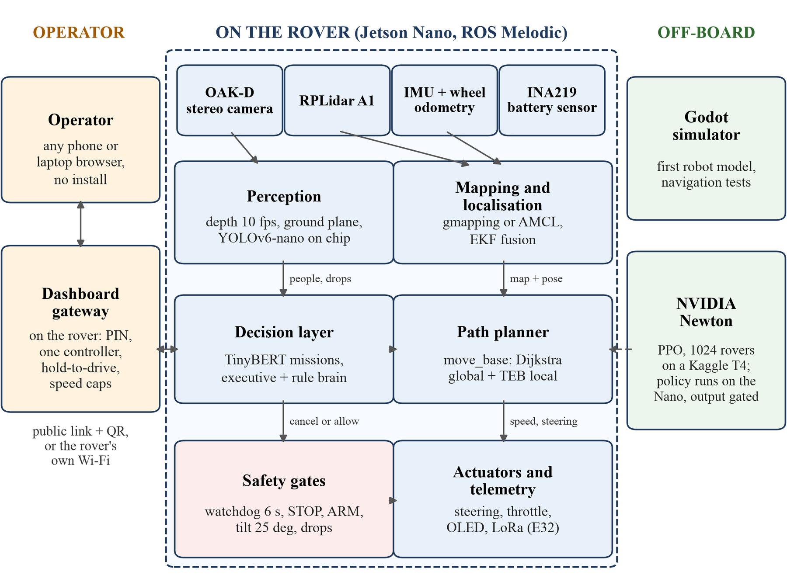</p>

Everything inside the dashed box runs on the Jetson Nano. The dashboard gateway also runs on the rover and
only serves a page to the operator's browser. The simulator and the GPU training are used before a run, never
during one.

<p align="center">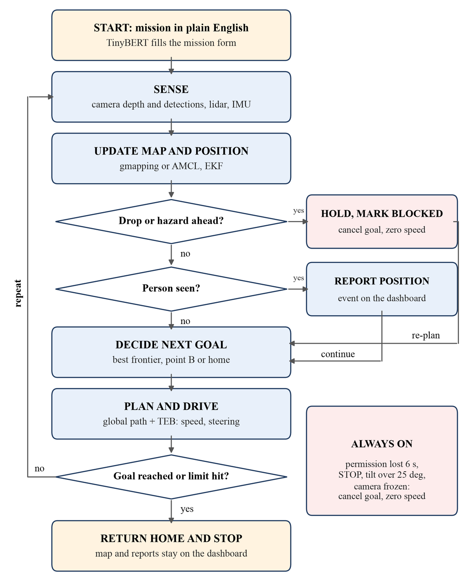</p>

## Results on the real rover

| What was measured | Result | Date (2026) |
|---|---|---|
| Autonomous tour | 74.0 m in 10 legs, 24.87 m from the start, an obstacle routed around on every leg | 23 Sep |
| Area mapped in that run | grew from 75 to 312.6 m² at 5 cm per cell | 23 Sep |
| Return-to-start error | 0.114 m on a separate 3.75 m closed loop (single run) | 22 Sep |
| Depth and detection | 10.0 fps on the camera chip, 97 % valid depth pixels | 26 Sep |
| Drop test at a raised edge | drop first seen 1.19 m ahead, rover stopped 0.43 m short | 26 Sep |
| False drops on glossy tiles | 82 of 82 frames blocked before our fix, 0 of 141 after | 30 Sep |
| Mission parser | 97.75 % exact on validation; median 45 ms parked, 52 ms under an emulated driving load, on the Nano CPU | 25 Sep |
| Decision layer | 57 of 57 tests on the rover, 43 to 54 ms per decision | 25 Sep |
| Remote dashboard | 27 of 27 end-to-end checks, 42 ms median round trip through the public link | 25 to 26 Sep |
| Offline cold start | 16 ROS nodes up in 6 s with no network | 24 Sep |

The full set, with the missions we typed on the rover and every safety test, is in
[docs/RESULTS.md](docs/RESULTS.md).

<table>
<tr>
<td width="50%">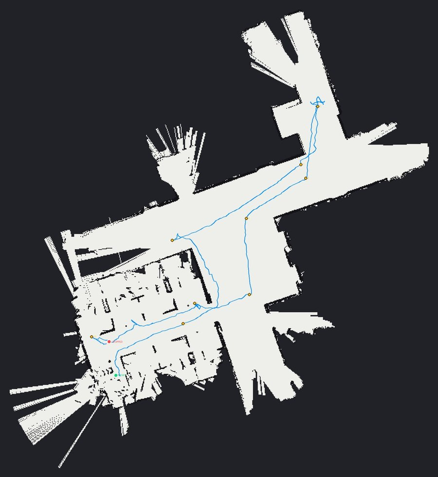<br><sub>The map built during the 74 m autonomous tour. The blue line is the path it drove.</sub></td>
<td width="50%">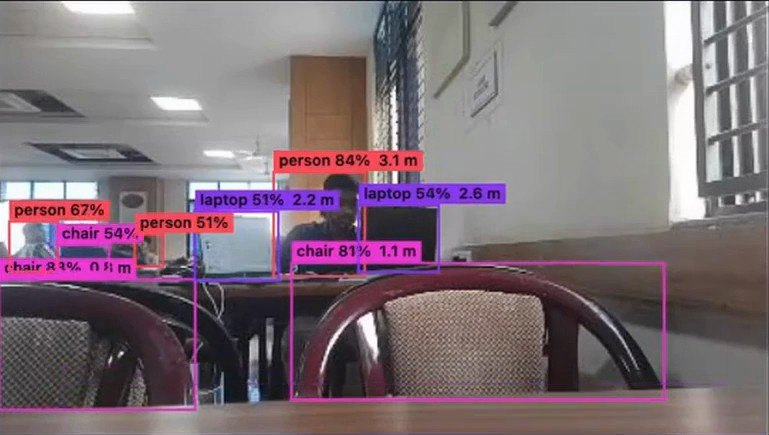<br><sub>Live detections on the dashboard, each with its class, confidence and distance.</sub><br><br>
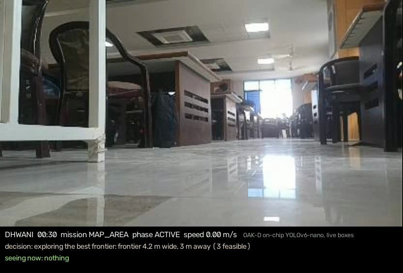<br><sub>A frame recorded by the rover during a mission, with the decision layer's status line.</sub></td>
</tr>
</table>

<p align="center">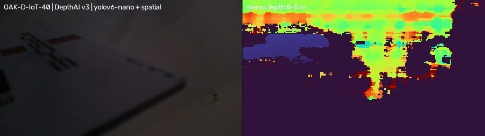<br><sub>Colour image and stereo depth from the OAK-D on the rover, coloured by distance up to 5 m.</sub></p>

<p align="center">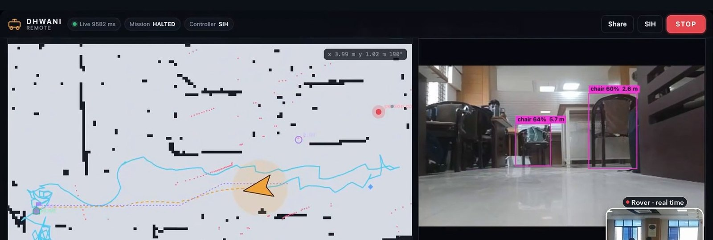<br><sub>The remote dashboard while driving: live map with the path driven, and the camera view with detections.</sub></p>

## What is not proven yet

We would rather say this here than have someone find it.

- Localisation uses the lidar today. Stereo visual odometry and visual SLAM on the camera are not built yet.
- The camera's hazard scan stops the rover and guards manual driving, but it is not yet part of the planner's costmap.
- The 74 m tour did not return to its start: a recovery script stopped it before its return phase. The 0.114 m
  return error is from a separate, shorter loop. Both are single runs.
- On a mirror-polished stone floor the stereo camera sees reflections of the ceiling below the floor, so drop
  detection has to be switched off there.
- The LoRa transmitter is fitted and answers on the Nano, but a link to a second radio has not been tested.
- The NVIDIA Newton driving policy has only driven in simulation.
- The rover loses power under motor load when the battery is low, and the wheel odometry is not calibrated.

## Hardware

| Component | Model | Role | Price (Rs) |
|---|---|---|---|
| Rover kit | Waveshare JetRacer Pro ROS AI kit | Jetson Nano 4 GB, Ackermann chassis, CSI camera, IMU, wheel encoders, OLED, battery sensor | 26,399 |
| Lidar | RPLidar A1M8 | 360° scan from 0.15 to 12 m | 6,777 |
| Stereo camera | Luxonis OAK-D-IoT-40 | stereo depth and on-chip neural inference | about 27,000 |
| Long-range radio | EBYTE E32 LoRa transmitter, 1 W | permission, position and alerts when Wi-Fi is gone | under 1,000 |
| **Total** | | | **about 61,000** |

No GPU is needed: detection and depth run on the camera's own chip. Wiring and setup notes are in
[docs/HARDWARE.md](docs/HARDWARE.md).

## Software

- **Rover:** Ubuntu 18.04 on the kit's Jetson image, ROS Melodic, Python 2.7 for the ROS nodes, Python 3.6 for the camera bridge and the dashboard
- **Mapping and planning:** gmapping, AMCL, map_server, move_base with global_planner and teb_local_planner, robot_pose_ekf, rosbridge
- **Camera:** DepthAI v3 with YOLOv6-nano on the OAK-D, run from a portable Python 3.10 environment on the Nano
- **Language and decisions:** TinyBERT mission parser and a rule-based decision layer in NumPy (OpenBLAS build)
- **Dashboard:** Python asyncio and websockets on the rover, a plain HTML and JavaScript page, a Cloudflare quick tunnel for the public link
- **Simulation and training:** a Godot 4 simulator, and NVIDIA Newton with the MuJoCo solver and PPO on a Kaggle T4 GPU

## Repository layout

```
nodes/       ROS nodes on the rover: mission executor and permission watchdog, junction detector,
             OAK-D bridge, policy runner
executive/   runs a parsed mission: asks the decision layer, sends move_base goals, safety cancels
brain/       dhwani_brain, the rule-based decision layer (frontiers, people, return home), with its
             simulator, tests and evaluation
parser/      TinyBERT mission parser: data generator, training, NumPy inference for the Nano, test sets
remote/      remote dashboard: gateway (asyncio + WebSocket), web page, start and stop scripts, tests
tools/       operator tools: mapping and localisation switch, waypoints, base station, LoRa link,
             mission recorder, Mac launcher
service/     boot service that starts and supervises the stack
oled/        OLED status display (Wi-Fi, battery, distance driven)
train/       NVIDIA Newton training for the driving reflex, with the training log and evidence
bench/       latency benchmarks on the Nano
maps/        the map built in the 74 m autonomous tour (23 Sep 2026)
docs/        results, hardware, setup, the interfaces between the parts, figures
```

The OAK-D pipeline that turns stereo depth into the hazard scan is not published in this repository yet.
The ROS bridge that consumes it, [`nodes/oak_node.py`](nodes/oak_node.py), and the topics it publishes
(`/oak/scan`, `/oak/cliff`, `/oak/person`, `/oak/status`) are.

## Getting started

The short version, for a JetRacer running the Waveshare ROS Melodic image:

```bash
# from a laptop: copy the dashboard to the rover (the full layout is in docs/SETUP.md)
ROVER=jetson@<rover-ip>
ssh $ROVER 'mkdir -p ~/dhwani_remote'
scp -r remote/* $ROVER:~/dhwani_remote/

# on the rover: install its three Python packages once, then start it in test mode
ssh $ROVER
cd ~/dhwani_remote
python3 -m pip install --target pylib "numpy==1.19.5" "websockets<10" segno
export DHWANI_PIN=<choose your own>        # never commit a PIN
./start_remote.sh --dry-run                # nothing can move in test mode
```

It prints a link and a QR code; open it on any phone or laptop. The full setup, with the ROS nodes,
the parser weights, the boot service, mapping and localisation, and going live, is in
[docs/SETUP.md](docs/SETUP.md). The messages between the parts are described in
[docs/INTERFACES.md](docs/INTERFACES.md).

## Safety

Every safety rule runs on the rover, because the operator's side is the one that loses the link.

| Rule | What happens |
|---|---|
| Permission watchdog | During a mission the console sends permission twice a second; after 6 s of silence the rover cancels its goal and stops |
| STOP for everyone | Anyone viewing the dashboard can press STOP; it holds until the controller resumes |
| ARM gate | The decision layer stays in test mode unless it is switched to live on the rover and the operator presses ARM |
| Camera fails loud | Frozen or missing camera frames cancel the goal and zero the speed |
| Tilt and drops | A tilt above 25° or a confirmed drop ahead cancels the goal and marks the area blocked |
| Manual driving | PIN, one controller at a time, hold-to-drive with a 0.5 s cut-off, 0.30 m/s and 1.2 rad/s caps on the rover, no forward motion with a hazard ahead |

## Simulation and training

<p align="center">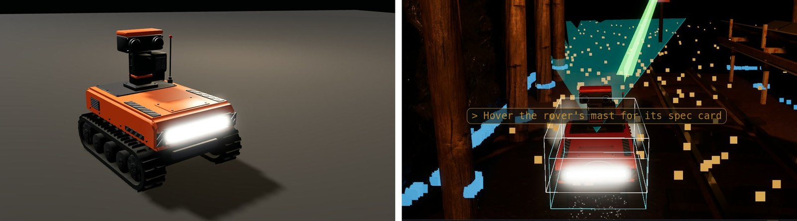<br><sub>Our Godot simulator: the first DHWANI robot model, and the robot exploring on its own.</sub></p>

The low-level driving reflex was trained with PPO in NVIDIA Newton, with 1024 simulated JetRacers in parallel
on a rough height map on a Kaggle T4 GPU, about 1400 times faster than real time. Against the same starts, the
trained policy reached **2.63 goals per rover against 1.45** for our hand-written controller, and flipped over
in 3 % of episodes against 12 %. It runs on the Nano at 50 Hz as a NumPy network, but its output is gated and
it has not driven the real wheels yet. All of these numbers are from simulation.

<p align="center">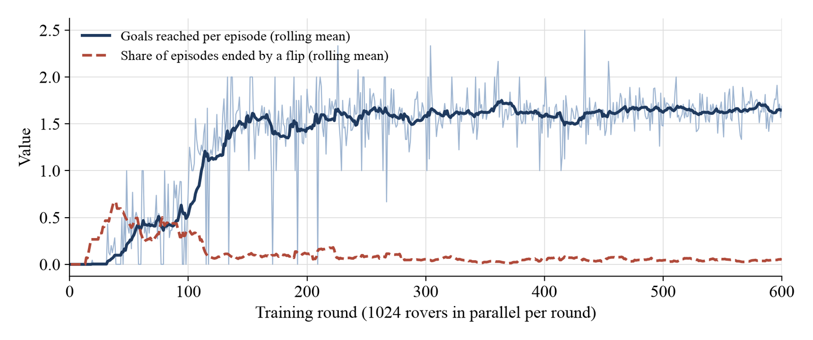</p>
<p align="center">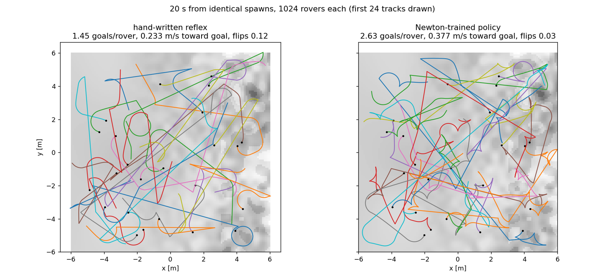</p>

## Roadmap

1. Stereo visual odometry and visual SLAM on the OAK-D (ORB-SLAM3 or RTAB-Map), graded against the lidar map
2. The camera's hazard scan inside the planner's costmap
3. A traversable-path segmentation model trained on outdoor terrain
4. Point A to point B trials outdoors with completion rate and replanning time, and repeats of the loop-closure test
5. Calibrated wheel odometry and a range test of the LoRa link
6. The Newton-trained reflex on the real wheels, after bench tests
7. A stronger chassis, a regulated supply for the camera and radio, and weatherproofing

## Team

Built by **Rudraksh Bharti** (Team FABLE 5, SA-HW-12), Department of Computer Science and Engineering,
MIT School of Computing, MIT ADT University, Pune, under the guidance of **Prof. Harshad Lokhande**.

## References

1. Smart India Hackathon 2026, "Problem Statement SIH26126: Vision Based Autonomous Navigation for Unmanned Ground Vehicle for Outdoor environment," Bharat Electronics Limited, Smart Automation theme. [Online]. Available: https://www.sih.gov.in/sih2026PS (accessed Sep. 2026).
2. S. Thrun, W. Burgard and D. Fox, Probabilistic Robotics. Cambridge, MA, USA: MIT Press, 2005.
3. G. Grisetti, C. Stachniss and W. Burgard, "Improved Techniques for Grid Mapping With Rao-Blackwellized Particle Filters," IEEE Transactions on Robotics, vol. 23, no. 1, pp. 34-46, 2007.
4. D. Fox, W. Burgard, F. Dellaert and S. Thrun, "Monte Carlo Localization: Efficient Position Estimation for Mobile Robots," in Proc. 16th National Conference on Artificial Intelligence (AAAI-99), Orlando, FL, USA, 1999, pp. 343-349.
5. Open Robotics, "move_base," ROS Wiki. [Online]. Available: http://wiki.ros.org/move_base (accessed Sep. 2026).
6. C. Rösmann, F. Hoffmann and T. Bertram, "Integrated online trajectory planning and optimization in distinctive topologies," Robotics and Autonomous Systems, vol. 88, pp. 142-153, 2017.
7. C. Li et al., "YOLOv6: A Single-Stage Object Detection Framework for Industrial Applications," arXiv:2209.02976, 2022.
8. Luxonis, "DepthAI documentation." [Online]. Available: https://docs.luxonis.com (accessed Sep. 2026).
9. C. Campos, R. Elvira, J. J. G. Rodríguez, J. M. M. Montiel and J. D. Tardós, "ORB-SLAM3: An Accurate Open-Source Library for Visual, Visual-Inertial, and Multimap SLAM," IEEE Transactions on Robotics, vol. 37, no. 6, pp. 1874-1890, 2021.
10. M. Labbé and F. Michaud, "RTAB-Map as an open-source lidar and visual simultaneous localization and mapping library for large-scale and long-term online operation," Journal of Field Robotics, vol. 36, no. 2, pp. 416-446, 2019.
11. X. Jiao, Y. Yin, L. Shang, X. Jiang, X. Chen, L. Li, F. Wang and Q. Liu, "TinyBERT: Distilling BERT for Natural Language Understanding," in Findings of the Association for Computational Linguistics: EMNLP 2020, 2020, pp. 4163-4174.
12. B. Yamauchi, "A frontier-based approach for autonomous exploration," in Proc. IEEE International Symposium on Computational Intelligence in Robotics and Automation (CIRA), Monterey, CA, USA, 1997, pp. 146-151.
13. J. Schulman, F. Wolski, P. Dhariwal, A. Radford and O. Klimov, "Proximal Policy Optimization Algorithms," arXiv:1707.06347, 2017.
14. NVIDIA, "Newton: GPU-accelerated physics simulation for robotics," GitHub repository. [Online]. Available: https://github.com/newton-physics/newton (accessed Sep. 2026).
15. R. Bharti, "SIH DHWANI rover: Newton and MuJoCo PPO training," Kaggle notebook, 2026. [Online]. Available: https://www.kaggle.com/code/rudrakshbharti/sih-dhwani-rover-newton-mujoco-ppo-training
16. Waveshare, "JetRacer ROS AI Kit Tutorial IV: Configure Multi-machine Communication." [Online]. Available: https://www.waveshare.com/wiki/JetRacer_ROS_AI_Kit_Tutorial_IV:_Configure_Multi-machine_Communication (accessed Oct. 2026).

## License

Released under the [Apache License 2.0](LICENSE). See [NOTICE](NOTICE).
