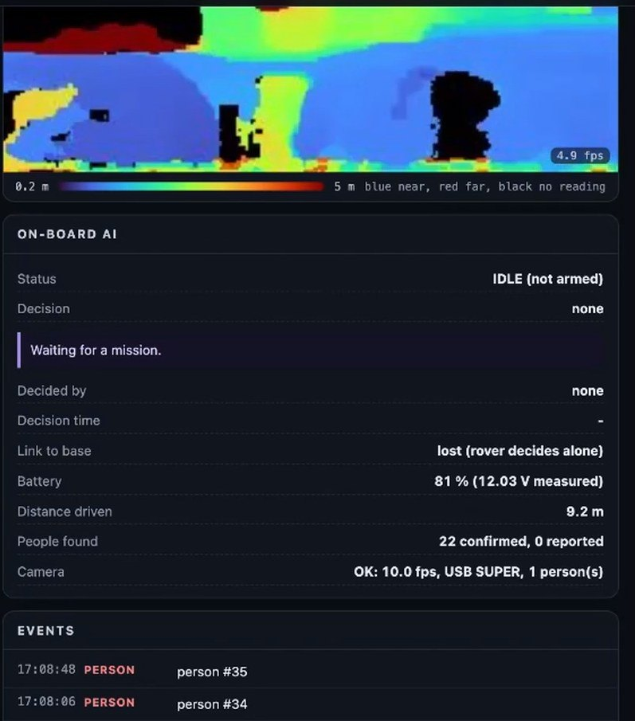

# Results

Everything below was measured on the real rover in September 2026, unless it says simulation.
Each figure is from a single run unless the table says otherwise; repeating the key ones is part
of our next stage.

## Measured on the rover

| What was measured | Result | Date (2026) |
|---|---|---|
| Autonomous tour | 74.0 m in 10 legs, 24.87 m from the start, an obstacle routed around on every leg | 23 Sep |
| Area mapped in that run | grew from 75 to 312.6 m² at 5 cm per cell | 23 Sep |
| Return-to-start error | 0.114 m on a separate 3.75 m closed loop | 22 Sep |
| Depth and detection | 10.0 fps on the camera chip over USB 3, 97 % valid depth pixels | 26 Sep |
| Person detection | a person about 2 m ahead, confidence 0.75 | 26 Sep |
| Drop test at a raised edge | drop first seen 1.19 m ahead, rover stopped 0.43 m short | 26 Sep |
| False drops on glossy tiles | 82 of 82 frames blocked before our fix, 0 of 141 after | 30 Sep |
| Manual driving guard | 0 of 39 forward commands passed with a hazard ahead; 37 of 37 reverse passed | 26 Sep (dry run) |
| Mission parser accuracy | 97.75 % exact on 2,000 validation instructions, 98.4 % on 192 written by hand | 25 Sep |
| Mission parser speed (median) | 45 ms parked with the full ROS stack, 52 ms with two extra busy cores standing in for driving load | 25 Sep |
| Decision layer | 57 of 57 tests on the rover, 43 to 54 ms per decision | 25 Sep |
| Dashboard | 27 of 27 end-to-end checks; 42 ms median round trip through the public link (95th percentile 88 ms) | 25 to 26 Sep |
| Offline cold start | 16 ROS nodes up in 6 s with no network, lidar at 8 Hz | 24 Sep |
| Wi-Fi round trip | 502 ms average with power saving on, 48 ms with it off | by 24 Sep |

Notes on two of these:

- **The tour did not return to its start.** A recovery script stopped the process before its
  return phase. The 0.114 m return error comes from the separate, shorter loop on 22 September.
- **The drop test stop.** The depth image put the edge 0.87 m ahead of the lens, and the test
  script capped the travel from that reading. The live drop reading appeared first at 1.19 m and
  closed in step as the rover moved. The stop itself came from the travel cap; the live drop alarm
  reached its own threshold in the same cycle.

 The map built in the 74 m autonomous tour on 23 September 2026. The blue line is the path the rover drove.

## Missions typed on the rover

| Mission typed | Parse time, confidence | What happened |
|---|---|---|
| "Map this whole room slowly and come back when done" (28 Sep) | 108 ms, 0.998 | Mission accepted; 11 people confirmed and reported in 80 s. Before the 30 Sep fix, no navigation goal reached the planner. |
| "Map this whole room in 10 minutes and come back" (30 Sep) | 55.7 ms, 0.999 | Drove 2.7 m on its own and confirmed and reported 5 people in 56 s; we stopped it because the library floor gave false drops. |
| "Map this area for 3 minutes and come back" (30 Sep) | 83.7 ms, 0.999 | Parsed and started, but the planner found no path among the people and desks, so we drove by hand from the dashboard instead. |

 The dashboard's live depth image and on-board AI panel during a mission.

## Safety and software tests

| Test | Expected | Result |
|---|---|---|
| Permission signal stops | rover cancels its goal and stops within 6 s | Pass |
| Camera not connected | status NO_DEVICE and no motion commands | Pass, 0 messages on `/cmd_vel` |
| Executive in test mode | decisions made, nothing sent to the wheels or the planner | Pass, 0 messages |
| Forward drive with a hazard ahead | blocked | Pass, 0 of 39 passed |
| Reverse with a hazard ahead | allowed | Pass, 37 of 37 |
| Dashboard end-to-end suite | all checks pass through the public link | Pass, 27 of 27 |
| Slow viewer with its phone asleep | other viewers not delayed | Pass after the fix, 5 of 5 within 1.8 s |
| Boot after a real reboot | stack starts on its own | Pass |
| Cold start with no internet | all nodes up and nothing calls the network | Pass, 16 nodes in 6 s |
| Drop at a raised edge | stops before the edge | Pass, 0.43 m short |
| Glossy tiles with nothing ahead | no false block | Pass, 0 of 141 frames |
| Mirror-polished library floor | no false drops | **Fail**, about 300 false points; drop check switched off there |

## Simulation (NVIDIA Newton)

The low-level driving reflex was trained with PPO in NVIDIA Newton, with 1024 simulated JetRacers
in parallel on a rough height map on a Kaggle T4 GPU, about 1400 times faster than real time
([notebook](https://www.kaggle.com/code/rudrakshbharti/sih-dhwani-rover-newton-mujoco-ppo-training)).
The policy only sees what the real robot can measure: 14 values from the IMU, the odometry, the goal
direction and distance, and its own previous command.

| From the same starting positions | Hand-written controller | Trained policy |
|---|---|---|
| Goals reached per rover | 1.45 | **2.63** |
| Episodes ending in a flip | 12 % | **3 %** |

The policy runs on the Nano at 50 Hz as a plain NumPy network and matches the training network to
within 2.4e-7, but its output is gated and it has not driven the real wheels yet. Training code
and logs are in [`train/`](../train).

## Decision layer, held out

We also trained a small learned policy for the decision layer. On 3,200 held-out simulated missions
it did not beat the hand-written rules, so it ships switched off and the rules run the rover. The
full evaluation is in [`brain/README.md`](../brain/README.md) and [`brain/eval/`](../brain/eval).

## What is not proven yet

- Localisation uses the lidar today. Stereo visual odometry and visual SLAM on the camera are not built yet.
- The camera's hazard scan stops the rover and guards manual driving, but it is not yet part of the planner's costmap.
- The 74 m tour and the 0.114 m loop closure are single runs, so there are no averages or spreads yet.
- Mirror-like floors defeat the drop detection, so it has to be switched off on them.
- The LoRa transmitter is fitted and answers on the Nano, but a link to a second radio has not been tested, so its range is unknown.
- The Newton-trained policy has only driven in simulation.
- The rover loses power under motor load when the battery is low, and the wheel odometry is not calibrated.
- The YOLO detector has no class for a rover. In an offline tracking test the rover itself kept getting new identities, so we need a detector trained on our own classes.
